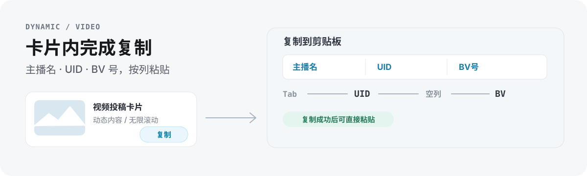

# B站动态一键复制关键信息

Tampermonkey 用户脚本，在 [B站动态页](https://t.bilibili.com/?tab=video) 视频投稿卡片右下角注入复制按钮，一键复制主播名、UID、BV 号。

  

## 适合谁

- 每天从动态页整理主播投稿，需要“名 + UID + BV”三件套的运营同学
- 不想在卡片与详情页之间来回跳转复制的人

## 能做什么

- 自动识别动态中的视频投稿
- 于视频卡片右下角显示「复制」按钮
- 点击后复制格式：`主播名` Tab `UID` Tab Tab `BV号`
- 支持无限滚动，新加载内容自动追加按钮

复制结果可直接粘贴进表格：主播名、UID、BV 号分别落列，中间预留的空 Tab 即表格空列。

## 安装

1. 安装 [Tampermonkey](https://www.tampermonkey.net/) 浏览器扩展
2. 打开 [bilibili-copy-info.user.js](./bilibili-copy-info.user.js)
3. 点击 **Raw** → Tampermonkey 会自动弹出安装窗口 → 点击 **安装**

用户脚本信息：`@name B站动态一键复制关键信息`，版本 `1.3.0`，匹配 `https://t.bilibili.com/*`，运行时机 `document-end`，权限仅 `GM_addStyle`，协议 AGPL-3.0。

## 使用

访问 <https://t.bilibili.com/?tab=video> ，每个视频投稿卡片的右下角会出现「复制」按钮，点击即可。

按钮平时为灰色描边，悬停变蓝色（`#00A1D6`），复制成功短暂变绿（`#52c41a`）。

## 限制

- 仅处理动态页中的视频投稿卡片；其它动态类型不加按钮。
- 复制格式固定为一名一 UID 一 BV，不含标题与链接；需要更多字段请改脚本。
- B 站动态页改版后选择器可能失效，以运行时为准。

## 许可证

本项目基于 [AGPL-3.0](LICENSE) 协议开源。
